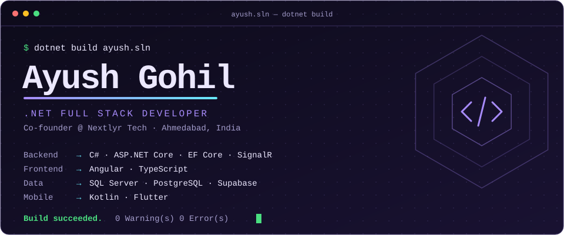
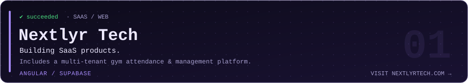
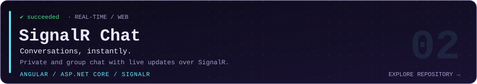
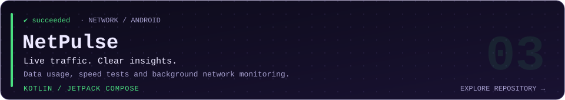
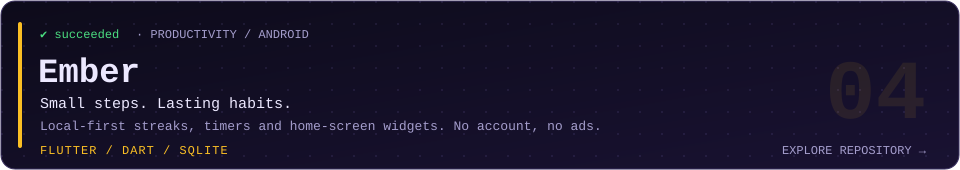
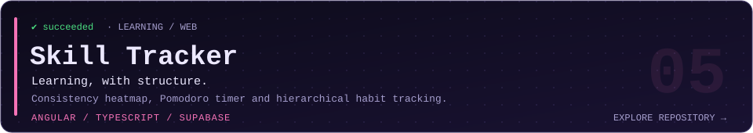
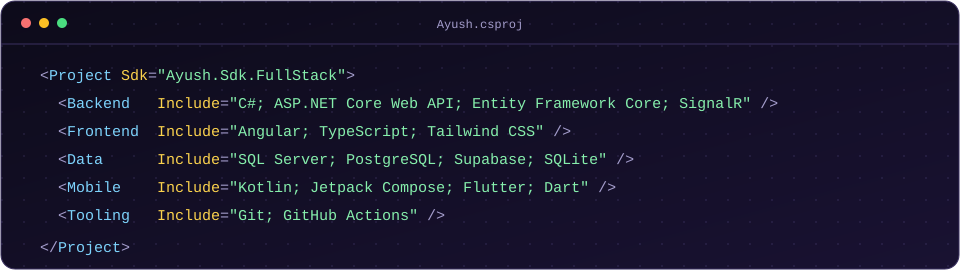

[**Projects**](#projects) · [**Toolbox**](#toolbox) · [**Nextlyr Tech**](https://nextlyrtech.com) · [**All repositories**](https://github.com/ayushgohil?tab=repositories)

I'm a **.NET full stack developer** with 2+ years of experience building web apps and SaaS products with C#, ASP.NET Core and Angular. I co-founded [Nextlyr Tech](https://nextlyrtech.com), and in my own time I build Android apps with a focus on privacy and local-first design.

I'm also pursuing my Masters alongside full-time work.

## Projects

Also: [Angular Whiteboard App](https://github.com/ayushgohil/Angular-Whiteboard-App), a real-time collaborative whiteboard built with Angular, SignalR and ASP.NET Core Web API.

## Toolbox

🌐 [nextlyrtech.com](https://nextlyrtech.com) · 📂 [github.com/ayushgohil](https://github.com/ayushgohil?tab=repositories)

